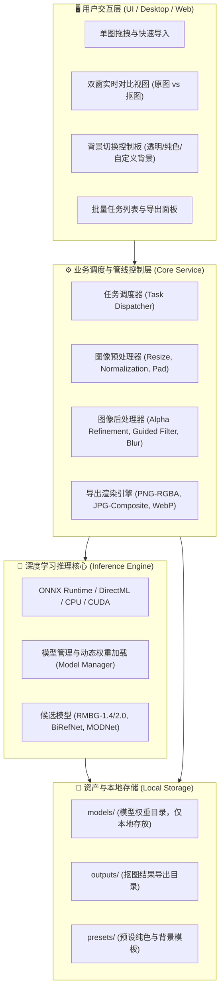

# 📌 项目宏观全景与演进状态 (PROJECT_STATUS.md)

> **当前版本**：v0.1.0-alpha  
> **远程仓库**：https://github.com/Scholar-52HZ/Fine-image-editing-tool.git  
> **最后更新**：2026-10-17  
> **版本流准则 (ADR-015)**：沙盒内门禁微快照自愈 + 主干 Squash 聚合 + 远程 Push 严格人工受权。  
> **状态维护原则**：本项目以仓库内文档为唯一事实来源（Single Source of Truth），所有 Agent 必须在此跟踪全局演进。

---

## 🎯 1. 项目定位与核心价值

**抠图工具 (Matting Studio / Tool)** 旨在构建一款**本地化、轻量级、高质量**的智能图片去背与发丝级抠图工具。支持单图极速处理与多图批量处理，支持人像、电商商品、动漫二次元、通用物品的主体分割与 Alpha 边缘平滑，具备快速替换背景（透明/纯色/自定义图片）及高保真导出能力。

---

## 🏗️ 2. 宏观系统架构全景



---

## 🧱 3. 规划目录结构

```text
抠图工具/
├── .ai/                               # 🤖【AI 专属资产与草稿】（被 .gitignore 排除）
│   ├── artifacts/                     # 生成图表、可视化预览、临时导出文件
│   └── scratch/                       # 一次性调试脚本、临时测试数据
├── AGENTS.md                          # 🤖 顶级多智能体协作与接手规范
├── docs/                              # 📁 规范文档核心
│   ├── PROJECT_STATUS.md              # 📌 宏观全景与演进状态（本文件）
│   ├── DECISIONS.md                   # 🏛️ 架构决策记录 (ADR)
│   ├── designs/                       # 📐 核心系统设计方案与视觉工作流规范 (真源)
│   │   ├── ecommerce_v3_director_workflow.md # 🎬 导演级 AI 电商多格视觉工作流系统方案 (v3.0)
│   │   ├── ecommerce_v2_redesign_plan.md     # 💎 AI 电商视觉工业级重构方案 (对标美图设计室)
│   │   ├── ecommerce_workflow_proposal.md    # 🛍️ AI 电商商用图文全自动合成系统完整方案
│   │   └── ecommerce_studio_mockup.html      # 🎨 电商商品智能工坊 UI 原型参考
│   └── tasks/                         # 📝 任务工单目录
│       ├── TASK-001-project-init-and-workflow-setup.md
│       ├── TASK-002-inference-engine-and-matting-prototype.md
│       └── TASK-TEMPLATE.md           # 任务模板
├── core/                              # ⚙️ 核心业务与推理逻辑 (已交付)
│   ├── engine/                        # 深度学习模型推理封装 (ONNX Runtime / RMBG / BiRefNet)
│   ├── pipeline/                      # 图像预处理、后处理与 Alpha 融合、换背景
│   └── cli.py                         # 命令行原型工具
├── ui/                                # 🖥️ 交互界面层 (双轨演进)
│   ├── desktop/                       # 方案 A: PySide6 桌面原生客户端 (独立软件体验)
│   └── web/                           # 方案 B: Gradio / Web 浏览器交互界面 (跨设备共享)
├── tests/                             # 🧪 自动化测试套件
├── models/                            # 🧠 离线模型权重存放区 (被 gitignore)
├── outputs/                           # 📤 默认导出目录 (被 gitignore)
├── .gitignore                         # 忽略项（大模型权重、输出图、.ai/ 缓存）
├── pyproject.toml                     # 项目元数据与依赖配置
├── requirements.txt                   # 通用依赖清单
└── README.md                          # 用户说明文档
```

---

## 🚀 4. 演进路线图 (RoadMap)

| 阶段 | 阶段目标 | 关键交付物 | 当前状态 | 关联任务 |
| :--- | :--- | :--- | :--- | :--- |
| **Phase 0** | 协作与接力框架搭建 | `AGENTS.md`, `docs/`, `.gitignore` | ✅ 已完成 | `TASK-001` |
| **Phase 1** | 推理核心与算法选型验证 | ONNX Runtime 推理封装、多模型动态切换、核心抠图与管线 | ✅ 已完成 | `TASK-002` |
| **Phase 2** | **方案 B：本地 WebUI 实现** | Gradio 工业级交互界面（单图精修、批量流水线、证件照工坊、模型说明） | ✅ 已完成 | `TASK-003` |
| **Phase 3** | **硬件加速与主动设备配置** | 硬件自动探测、默认 CPU/可选 DirectML GPU、提速 10.26 倍 | ✅ 已完成 | `TASK-004` |
| **Phase 4** | **三位一体模型分层管理与加速** | 内置 4.5MB 极轻模型、models/ 离线包优先、自有 Release 镜像 | ✅ 已完成 | `TASK-005` |
| **Phase 5** | **电商商品智能工坊全链路自动化** | 物理级双层阴影、画布几何自适应留白、程序化展台库、语义文案裂变与多平台规格式排版 | ✅ 已完成 | `TASK-006` |
| **Phase 6** | **导演级多智能体电商视觉工厂** | 一键创作 + 轻量内部工作流 + A/B 接入 + 自由场景与镜头情绪 + 局部重做 + 矢量排版 | 🔄 v3.1 设计已修订，阶段 1 尚未实现 | `TASK-007` |
| **Phase 7** | **单前端双端同构与全本地桌面交付** | 现代化高颜值前端 + 100% 纯本地离线 PyWebView JS-API 桌面打包 (ADR-011) | 📅 方案已锁定 / 待推进 | `TASK-008` |


---

## 📦 5. 已交付成果清单 (Delivered Capabilities)

- **2026-10-17 (TASK-007，设计成果)**：主方案修订至 v3.1，明确“一键创作、内部工作流、按需局部重做、轻量化”；补齐图像服务协议、素材/事实约束、任务恢复与资源预算，归档 ADR-016。仅设计交付，网关、执行器与导演成图流程尚未实现。依据：`docs/designs/ecommerce_director_agent_system.md`。
- **2026-10-14 (TASK-001)**：搭建完毕多智能体无缝协作与接力框架（`AGENTS.md`、`docs/PROJECT_STATUS.md`、`docs/DECISIONS.md`、`docs/tasks/TASK-TEMPLATE.md`、`TASK-001`、`.gitignore`、`.ai/`）。
- **2026-10-15 (TASK-002)**：
  - 构建 Python 3.11 独立虚拟环境与现代化依赖管理（`pyproject.toml` / `requirements.txt`）；
  - 实现核心多模型推理引擎 `AutoMattingEngine`（基于 ONNX Runtime，支持 `bria-rmbg`、`birefnet-general`、`birefnet-portrait`、`u2net`、`u2netp`、`silueta` 等）；
  - 实现全套图像后处理管线 `core/pipeline/`（Alpha 遮罩高斯羽化、OpenCV 孤立噪点与内部微小空洞自动修复、发丝边缘反光色溢净化 Defringe、透明/纯色/自定义图片背景合成）；
  - 交付完整 CLI 原型工具 `core/cli.py`；
  - 编写全面的自动化测试套件 `tests/`（9 项全过）。
- **2026-10-15 (TASK-003)**：
  - 全面实现本地 WebUI 交互系统（`ui/web/app.py`、`ui/web/service.py`、`webui.py`）；
  - **四大交互工作台**：
    1. **单图精修工坊**：支持拖拽上传、样例一键加载、交互式卷帘对比 (ImageSlider)、纯色与自定义图片换底、发丝精细羽化/降噪/去色溢微调；
    2. **批量流水线工坊**：多图批量拖入上传、统一背景策略应用、实时进度清单、自动打包 ZIP 压缩包下载；
    3. **证件照换底中心**：标准一寸/二寸冲印级尺寸规范、红/白/蓝官方底色一键生成、自动人像居中裁剪；
    4. **模型与架构说明**：离线模型特性比对、数据私密性说明；
  - 交付全量自动化测试套件 `tests/test_webui.py`，全项目 17 项测试 **100% 通过**。
- **2026-10-16 (TASK-004)**：
  - **DirectML 硬件加速通道**：引入 `onnxruntime-directml`，基于 DirectX 12 释放 NVIDIA GeForce GTX 1650 显卡算力；
  - **硬件探测与解耦工具**：编写 `core/utils/hardware.py`，精准自动探测 CPU 型号与核心数、独立显卡与显存、系统内存容量以及 ONNX Runtime Providers，并提供进程内缓存与安全超时兜底；
  - **主动配置方案落地**：
    - 严格遵循**“默认 CPU、用户可选 GPU”**设计铁律；
    - WebUI 顶部增加全局硬件实时状态看板（显示当前运行模式、速度预估与显卡就绪状态）；
    - 单图精修、批量流水线、证件照工坊均新增“使用设备 (Device)”单选器（默认选中 CPU 模式，可一键切换为 DirectML GPU 模式）；
    - CLI 命令行新增 `--device [cpu|gpu]` 参数（默认 cpu）；
  - **实测性能大幅提速**：
    - CPU 软解推理平均耗时：`355.8 ms`；
    - DirectML GPU 加速平均耗时：`34.7 ms`；
    - **实测加速比：10.26 倍！** 高精 1024x1024 发丝模型从 15~20s 缩减至 1~1.5s；
  - **全量自动化测试**：编写 `tests/test_hardware.py`，项目全量 23 项测试 **100% 通过**；
  - **沉淀技术决策**：在 `docs/DECISIONS.md` 归档 **ADR-009**。
- **2026-10-16 (TASK-005)**：
  - **三位一体模型分层管理架构落地**：
    1. **极轻核心内置**：将 4.5MB 极轻基准模型 `u2netp.onnx` 正式内置于 `models/`，在 `.gitignore` 中解除排除，实现 0 毫秒下载等待开箱即用；
    2. **三级本地优先解析**：开发 `core/utils/model_manager.py` 并注入 `rembg`，优先检索 `models/` 离线包与本地全局缓存；
    3. **自有 GitHub Releases 独立源 + 国内高速镜像**：将大模型托管与 Git 提交彻底解耦，下载时自动挂载 `ghfast.top` / `ghproxy.net` 代理前缀，免代理跑满带宽；
    4. **WebUI 第五大工坊【📦 离线模型管理 (Model Hub)】**：上线就绪状态数据清单、离线包导入指引与一键高速预下载；
    5. **安全防截断机制**：核心抠图流程前置校验模型就绪状态，杜绝静默卡死；
  - **测试与文档沉淀**：新增 `tests/test_model_manager.py`，项目全量 28 项自动化测试 **100% 通过**；归档 **ADR-010**。
- **2026-10-16 (TASK-006)**：
  - **电商商用图文全自动工作流全栈交付 (阶段一 ~ 阶段三)**：
    1. **阶段一（电商主图基石）**：
       - `core/pipeline/shadow.py`：开发物理级真实光影发生器，支持紧贴地面贴合暗角的硬质接触阴影 (Contact Shadow)、大范围柔光漫反射投影 (Ambient Shadow) 与磨砂镜面微倒影 (Mirror Reflection)；
       - `core/pipeline/framing.py`：开发平台规范留白与几何自适应引擎 (Auto-Framing)，支持精确 Bounding Box 计算与锚点定位；
    2. **阶段二（商业展台与交互工作台）**：
       - `core/pipeline/podium.py`：开发程序化 3D 商业展台库（大理石微距圆柱台、北欧温润原木托盘、清透水面波纹光影、摄影棚极简几何块），底座与主体接触面自适应贴合；
       - WebUI 界面正式上线全新第 4 个专属操作台：**【🛍️ 电商商品工坊 (E-Commerce Studio)】**；
    3. **阶段三（智能文案策划与多平台规格式批量排版）**：
       - `core/pipeline/copywriter.py`：开发基于产品名、功效用途与受众的智能商业文案裂变器，自动产出痛点大标题、核心卖点标签、营销角标与权威背书；
       - `core/pipeline/layout.py`：基于 PIL 纯本地渲染引擎，一键秒级生成：**淘宝/天猫 800x800 爆款主图**、**亚马逊 1000x1000 严格合规白底图 (85%留白+漫反射暗角)**、**小红书 3:4 (900x1200) 种草大片**、**详情页 750px 核心卖点长条**；
       - `ui/web/service.py` 自动化端到端打包生成 `.zip` 资产包；
  - **全量自动化测试**：新增 `tests/test_ecommerce.py`，项目全量 34 项测试 **100% 通过 (17.80s)**；归档 **ADR-012**。


---

## 🧪 6. 验证与运行命令速查

- **一键启动本地 WebUI (推荐)**：
  ```bash
  .venv\Scripts\python.exe webui.py
  # 浏览器访问: http://127.0.0.1:7860
  ```
- **激活环境并运行全量测试套件 (28 项)**：
  ```bash
  .venv\Scripts\python.exe -m pytest tests/ -v
  ```
- **查看内置支持的所有抠图模型**：
  ```bash
  .venv\Scripts\python.exe -m core.cli --list-models
  ```
- **单图抠图 (默认 CPU 模式)**：
  ```bash
  .venv\Scripts\python.exe -m core.cli input.jpg -o output.png --model bria-rmbg
  ```
- **单图抠图 (启用 GPU DirectML 硬件加速)**：
  ```bash
  .venv\Scripts\python.exe -m core.cli input.jpg -o output.png --model bria-rmbg --device gpu
  ```

- **证件照/纯色换底 (如换白底、红底或标准证件蓝)**：
  ```bash
  .venv\Scripts\python.exe -m core.cli input.jpg -o output.jpg --bg-color "#FFFFFF"
  .venv\Scripts\python.exe -m core.cli input.jpg -o output.jpg --bg-color "id_blue"
  ```
- **批量处理指定目录下所有图片**：
  ```bash
  .venv\Scripts\python.exe -m core.cli ./images/ -o ./outputs/ --model u2netp
  ```
- **开启发丝精细羽化与色彩边缘净化**：
  ```bash
  .venv\Scripts\python.exe -m core.cli portrait.jpg -o portrait_clean.png --feather 1.0 --denoise --defringe
  ```
