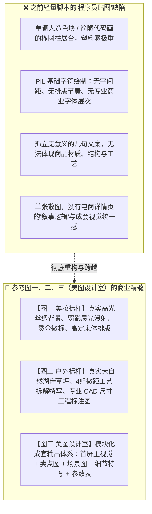
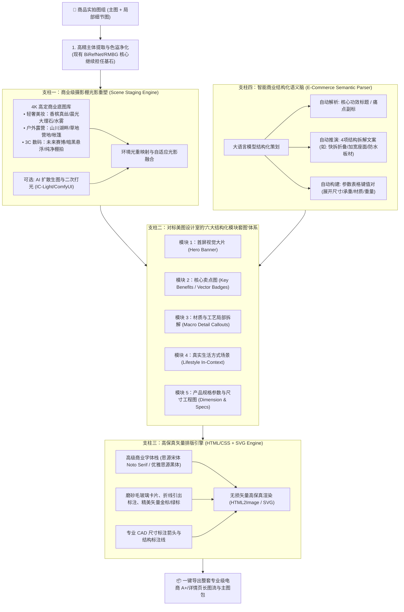

# 💎 AI 电商视觉工业级重构方案：对标「美图设计室」与高定商业大片

> **文档代号**：E-Commerce Studio 2.0 Architectural Overhaul  
> **设计对标**：美图设计室 (DesignKit.cn) · 国际 A+ 详情页标准 · 美妆轻奢/户外生活方式商业级成套图  
> **核心诊断**：彻底废弃“抠图后简单贴字”的简陋程序员绘制逻辑，构建**“商业场景光影重塑 + 六大结构化详情页模块 + HTML/SVG 矢量排版引擎 + 真实产品拆解图”**的工业级视觉中台。

---

## 🔍 1. 深度复盘与核心问题诊断：为什么之前的输出没有商业美感？

对照您提供的三张行业标杆参考图，我们现存逻辑与商业级工具存在本质的“代际差距”：

---

## 🏛️ 2. 全新 2.0 系统架构：四大支柱重构设计

要达到图一、图二和美图设计室的商业交付水准，系统必须建立在以下 **四大核心支柱** 之上：

---

## 🎨 3. 核心支柱实施细节：如何完美复刻参考图？

### 3.1 完美复刻【参考图一：美妆轻奢质感】
- **场景底板**：
  - 弃用代码手绘纯色！采用 **4K 真实摄影棚香槟色丝绸褶皱底板** + **斜射柔光窗格阴影**；
  - 瓶身底部与底座形成真实的高光倒影与柔和漫反射环境光。
- **排版系统**：
  - **字体**：选用 **思源宋体 (Noto Serif SC)**，字符间距微张 (`letter-spacing: 0.15em`)，展现奢华呼吸感；
  - **图标徽章**：采用 **金色细线圆环微标 (Fine-line Gold Badges)**，内置水滴、凝霜、海浪等微矢量图标；
  - **配色体系**：从商品提取主色调，文字采用香槟棕黑 (`#4A3728`)，辅以暗红或墨绿小点缀。

### 3.2 完美复刻【参考图二：户外装备详情流】
- **真实场景合成**：
  - 商品沉浸式置入**真实草地、湖光山色、阳光斜照**的环境中，地面具备真实的草丛压痕与自然树影。
- **4 组结构与工艺拆解卡片 (Feature Callout)**：
  - 支持用户上传或系统自动截取 4 张关键特写：
    1. `折叠收纳态`（说明轻便小巧）
    2. `X型交叉受力骨架`（说明承重安全）
    3. `加厚牛津布座面`（说明舒适耐磨）
    4. `防水耐脏桌面微距`（带真实水珠微距特写）
  - 每张卡片带有圆角微边框、深色编号角标 (`❶ ❷ ❸ ❹`)、精炼标题与工艺参数。
- **产品参数与工程尺寸标注图 (CAD Dimensions)**：
  - 自动渲染专业 **双向尺寸箭头线**（如标明：长 95cm、宽 55cm、高 50cm）；
  - 规范结构化参数表格（产品名称、材质、展开尺寸、收纳尺寸、承重指标、适用场景等），具有极高商业信服力。

### 3.3 深度对标【参考图三：美图设计室 (DesignKit) 交互体系】
- **工作流界面完全重塑**：
  - **左侧控制面板**：
    1. **多图上传池**：支持上传同一产品的 1~6 张多角度/细节图（主图、折叠图、局部图）；
    2. **平台与类目模板选择器**：亚马逊 A+ (美/日/德/英)、淘宝天猫详情页、小红书种草长图；
    3. **包含模块多选框 (Modules Selection)**：
       - `[x] 首屏主视觉`（传递核心价值与氛围）
       - `[x] 核心卖点图`（突出集成优势与卖点标签）
       - `[x] 材质与细节特写`（4 组工艺放大微距卡片）
       - `[x] 使用场景图`（居家/户外真实环境融合）
       - `[x] 产品规格参数与尺寸图`（带尺寸线与标准属性表）
    4. **“AI 帮写”智能策划按钮**：输入一句话产品名，自动填充全套卖点、拆解部位与参数模版。
  - **右侧画廊区**：
    - 不再是单张孤立图，而是**成套连续的长图流水线预览**，支持单张微调与全套长图无缝导出。

---

## 🛠️ 4. 技术栈革命：从 PIL 升级到现代化排版渲染管线

| 维度 | 现有的简陋实现 (1.0) | 升级后的工业级标准 (2.0) |
| :--- | :--- | :--- |
| **场景生成** | OpenCV 代码手绘纯色/几何椭圆 | **4K 商业场景底图库 + 景深透视贴合 (可选 IC-Light AI 重新打光)** |
| **排版引擎** | PIL `ImageDraw.text` 坐标死算 | **HTML5 + CSS3 + Tailwind + SVG 矢量排版引擎** (支持 flex/grid、阴影、微字距、滤镜) |
| **渲染通道** | 粗糙光栅化位图 | **无头浏览器 (Headless Chrome / Playwright) 毫米级无损转图** |
| **图文资产** | 纯文字 + 简陋长方形 | **丰富矢量图标库 (Lucide Icons) + 编号徽章 + 尺寸标注线 + 材质卡片** |
| **内容组织** | 仅单张主图概念 | **成套详情页 5~8 模块组合流 (A+ 规范)** |

---

## 🚀 5. 分阶段开发落地计划

- **第一阶段（场景与底模革新）**：
  - 接入精选商业级美妆与户外等高分辨率 4K 场景图库（丝绸、大理石、草坪湖泊）；
  - 实现基于环境光方向的多层柔光投影与边缘微反光融合。
- **第二阶段（HTML/SVG 矢量模版引擎与四大模块）**：
  - 搭建基于 HTML/CSS 的商业模版渲染器（彻底淘汰 PIL 贴字）；
  - 完成【美妆轻奢模板】与【户外工艺拆解与尺寸标注模板】。
- **第三阶段（美图设计室级 UI 工作台与成套生成）**：
  - 按照 DesignKit 结构升级 WebUI，支持多图上传、模块勾选、“AI 帮写”与成套 A+ 详情页一键打包导出。
