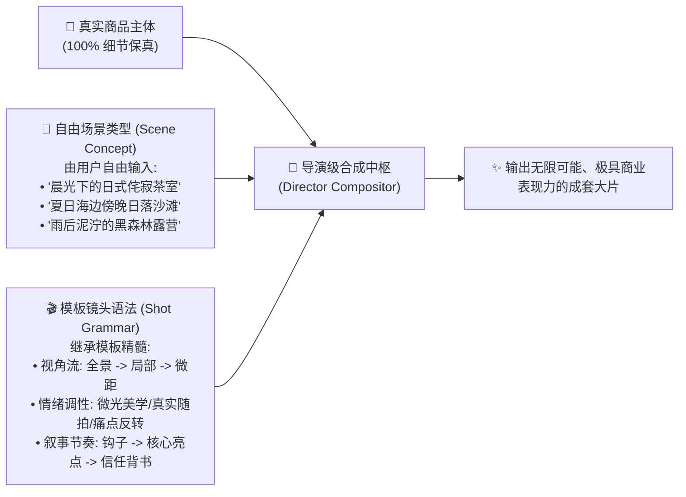
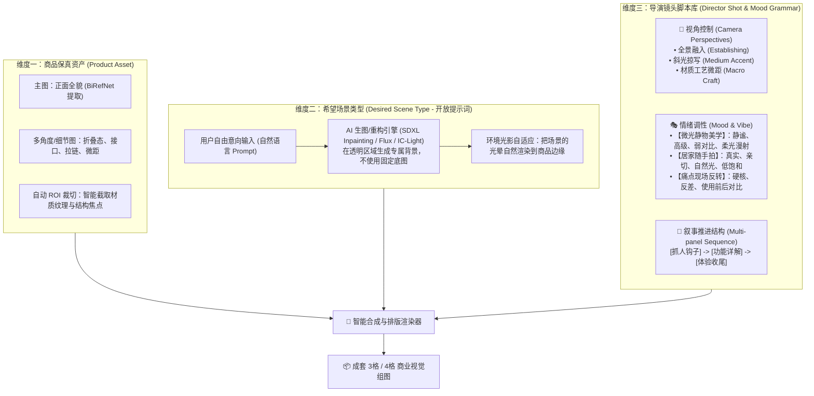

# 🎬 导演级 AI 电商多格视觉工作流系统方案

> **系统代号**：Director-Style E-Commerce Multi-Shot Engine (v3.0)  
> **核心哲学**：**「场景类型无限自由（由用户意图生成） × 模板传承镜头语法（视角 + 情绪 + 叙事推演）」**  
> **设计超越**：彻底摆脱固定商用底图的局限，从“静态模版套图”升维为**“商业摄影导演系统”**。

---

## 💡 1. 核心架构认知：为什么这是超越 DesignKit 的更高级范式？

传统工具（如美图设计室部分功能）的局限在于：**“模板绑定死图”**——模板是什么底图，用户就只能用什么底图，极易千篇一律、缺乏定制灵活性。

您提出的**“场景自由定义 + 保留模板的视角与情绪”**，本质上是**商业视觉的终极解耦**：

---

## 🏛️ 2. 三维解耦系统架构设计

系统由 **三大独立可控维度** 自由交叉组合而成：

---

## 🎬 3. 典型镜头脚本与情绪语法解构库

我们从优秀的电商多格模版中提炼出的不是死板的图片，而是**可复用的镜头导演规则**：

### 语法模式 1：【微光静物美学】(Subtle Light Still-Life Aesthetic)
- **情绪内核**：静谧、轻奢、内敛、克制的高级感（适合美妆、香氛、轻奢饰品、小家电）；
- **光影特征**：侧逆光掠过边缘，环境漫反射弱光，细长优雅的深色投影；
- **三格镜头推进**：
  1. **镜头 1（斜光掠写）**：平视 15°，主体占 60%，光束从侧方切入，勾勒商品流线高光；
  2. **镜头 2（局部微工）**：中景 45°，聚焦瓶盖金属拉丝或按压泵头，景深虚化；
  3. **镜头 3（空间全景）**：远景，商品在用户指定的自定义场景中（如“日落法式壁炉旁”）呼吸沉静；
- **排版风格**：思源宋体，极细英文字母间距，细线金色/冷灰点缀。

---

### 语法模式 2：【痛点现场到解决】(Problem to Solution & Proof)
- **情绪内核**：真实、直击痛点、信服力强、实用主义（适合清洁用品、户外工具、收纳神器）；
- **光影特征**：明亮自然光、高清晰度、无过多艺术滤镜；
- **三格镜头推进**：
  1. **镜头 1（麻烦现场）**：特写痛点场景（如泥泞地面、杂乱电线、干裂皮肤）；
  2. **镜头 2（逐步使用）**：商品动态介入使用中的形态（如折叠开合、按压出液）；
  3. **镜头 3（收纳/成效干净）**：解决后的清爽状态，带勾选标签与对比参数；
- **排版风格**：加粗黑体、荧光色标注胶囊、醒目数字标尺、箭头流程引导。

---

### 语法模式 3：【生活方式日常种草】(Casual Lifestyle In-Context)
- **情绪内核**：随性、去商业化广告感、UGC 真实感（适合家居日用、服饰鞋包、数码桌面）；
- **光影特征**：午后自然天光、微颗粒胶片质感、生活杂物虚化背景；
- **三格镜头推进**：
  1. **镜头 1（随手一放）**：随手放置在用户指定的场景中（如“床头柜角”、“露营折叠桌角”）；
  2. **镜头 2（手持上手）**：模拟人手持握或佩戴的交互第一视角；
  3. **镜头 3（材质特写）**：织物编织纹路、皮质毛孔或缝线的极微距镜头；
- **排版风格**：手写注记体、小红书标签样式、纯白微卡片。

---

## 🛠️ 4. 落地实操路径：如何让自由场景真正生成出来？

为了实现“任意场景生成 + 完美匹配视角与情绪”，系统采取两套算力管道方案：

1. **管道 A：基于 ControlNet + IC-Light 的真实光影生成**：
   - 输入：`商品透明图` + `希望场景文本 (如: 冰岛苔原岩石)` + `模板视角约束 (如: 45度俯视微距)` + `情绪光影提示 (如: 冷调晨雾散光)`；
   - 算法：在透明背景区域根据语义扩散作画，IC-Light 自动将苔原的冷光自然晕染到商品边缘，商品与新场景融为一体。
2. **管道 B：智能场景合成与虚化景深引擎 (对 4GB 显存极友好)**：
   - 用户输入场景关键词，系统通过动态生成或高分辨率商业素材库实时检索该场景特征；
   - 自动按照镜头语法的视角调整景深虚化（前实后虚），并依据模板情绪应用对应的专业 3D LUT 色调映射（如日落暖调、冷灰科技、胶片日系）。
