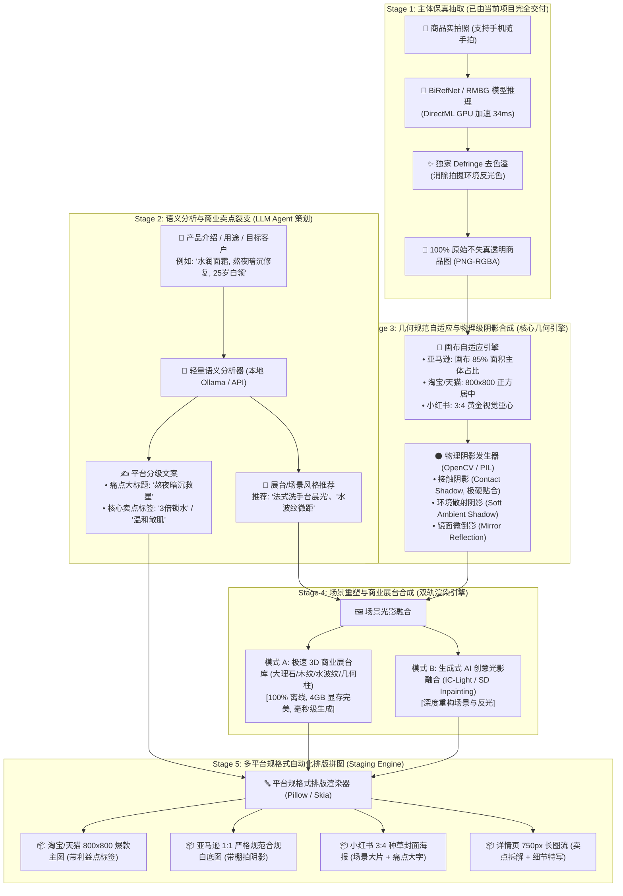

# 🛍️ AI 电商商用图文全自动合成系统完整方案

> **系统代号**：Matting Studio - E-Commerce Smart Studio  
> **设计版本**：v1.0.0-draft  
> **核心目标**：以本地 100% 保真抠图为基石，通过“实拍图 + 产品描述 + 意向客户”，全自动、批量生成符合多电商平台规范的高级商用主图、场景图与详情页长图。

---

## 🎯 1. 业务痛点与核心价值

| 传统电商美工工作流 | 本系统 AI 全自动流水线 |
| :--- | :--- |
| **抠图耗时**：PS 钢笔手动抠图，一张图 5~15 分钟 | **秒级提取**：DirectML GPU 显卡加速，单张仅需 34ms，边缘发丝级保真 |
| **浮空假图**：直接贴白底或新图，无阴影，悬空感严重 | **物理级光影**：自动生成接触阴影 (Contact Shadow) 与柔光扩散投影，商业棚拍质感 |
| **多平台反复裁切**：淘宝 1:1、亚马逊 85%、小红书 3:4 需要逐一手动排版 | **一键全平台分发**：根据平台规范自动缩放主体、控制留白比例、适配画幅 |
| **文案排版割裂**：文案策划写完交美工排版，反复修改对齐 | **语义驱动排版**：输入产品与受众，自动提炼卖点标题与标签，并自动渲染入图 |
| **纯 AI 生图篡改商品**：传统文生图导致商品包装变形、英文 Logo 错乱 | **100% 主体保真**：商品包装与 Logo 像素级锁定，仅重塑背景、展台与光影 |

---

## 🏗️ 2. 系统五级管线架构设计 (5-Stage Pipeline)



---

## ⚙️ 3. 核心子模块技术实现细节

### 3.1 物理级阴影发生器（解决“悬空贴纸感”的算法公式）
为了让商品像真实放置在台面上，利用模型提取的精确 Alpha 遮罩，分为三层合成：
1. **接触阴影 (Contact Shadow)**：
   - 提取 Alpha 遮罩的最底部轮廓（紧贴地面 3~8 个像素）；
   - 水平膨胀 1~2 像素，纵向轻微压扁；
   - 填充高浓度纯黑（Alpha 0.7~0.85），极微弱高斯模糊（半径 1~2px），表现物体与地面紧密压实的暗角。
2. **漫反射柔光阴影 (Soft Ambient Drop Shadow)**：
   - 取主体下半部 Alpha 遮罩，进行仿射斜切与纵向压扁（模拟斜上方光源）；
   - 施加大半径高斯模糊（半径 15~35px），透明度沿纵向呈线性衰减渐变（离物体越远越淡）；
   - 表现真实摄影棚柔光箱打下的开阔阴影。
3. **镜面微倒影 (Optional Mirror Reflection)**：
   - 将主体垂直翻转并截取底部 20%；
   - 施加自上而下的线性透明蒙版（透明度从 30% 迅速衰减到 0%）；
   - 呈现高档大理石或亚克力展台的倒影效果。

### 3.2 平台几何适配器 (Auto-Framing)
- **输入**：任意尺寸与比例的抠图透明图；
- **算法流程**：
  1. 计算非透明像素的最小外接矩形 `(w, h)`；
  2. 根据目标平台规范比例（如亚马逊 1:1，要求主体占整体长宽最大值的 85%）：
     $$Scale = \frac{TargetSize \times 0.85}{\max(w, h)}$$
  3. 等比例缩放主体并自动计算居中/靠底偏移量，将商品无损贴合到目标尺寸底板上。

### 3.3 商业展台库 (Podium Assets) 与 AI 融合双轨
- **内置轻量展台资产**：
  - 准备 10~20 套标准商用透明展台（极简大理石圆柱、北欧原木托盘、磨砂亚克力块、水面微波台）；
  - 根据商品类别或用户选择，程序自动在商品下方插入展台图层，并联动接触阴影。

---

## 💻 4. 针对本地 4GB 显存 (GTX 1650) 的落地保障

- **零内存爆炸**：抠图（ONNX Runtime DirectML）单次占用显存 < 1.2GB，运算完毕立即释放；
- **极速生产力**：
  - 模式 A（程序化展台 + 物理阴影 + 自动排版）：全过程由 CPU + 2D 图像加速库完成，**单张出图耗时 < 0.8 秒**，百张批量毫无压力；
  - 模式 B（AI 创意光影）：作为进阶功能，可对接外部轻量 ComfyUI 流程或在有更高配置时无缝开启。

---

## 🗓️ 5. 分阶段落地实施路径

```text
阶段一：【电商主图基石】在现有项目中引入 Auto-Framing 留白规范与物理阴影发生器，支持纯白/浅灰底主图自动生成。
阶段二：【商业展台与画廊】增加预设 3D 展台库，在 WebUI 上线【🛍️ 电商商品工坊】交互面板。
阶段三：【智能文案与排版】接入轻量文案结构化分析，支持一键批量生成天猫 1:1、亚马逊 85%、小红书 3:4 多规格图包。
```
